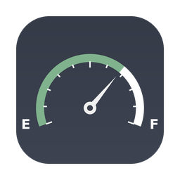
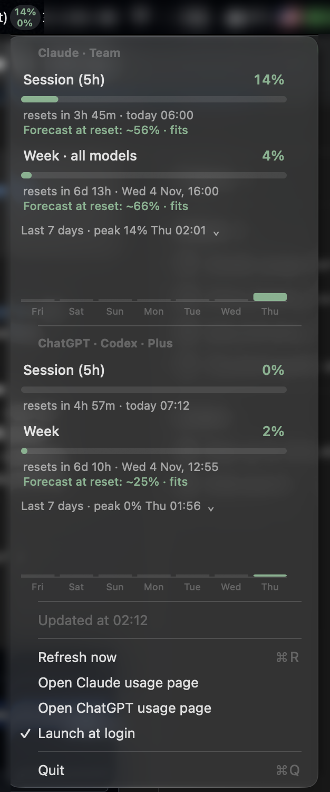

<p align="center">
  
</p>

<h1 align="center">Tank Tick</h1>

<p align="center">
  How much is left in the tank? A native macOS menu bar app showing your <b>Claude</b> (Pro/Max) and <b>ChatGPT</b> (via Codex) plan limits — with reset timers, a pace forecast and 7‑day history.
</p>

<p align="center">
  
</p>

## What you get

**Menu bar** — two small stacked numbers: Claude 5‑hour window on top, ChatGPT 5‑hour window below. Muted green / amber / red by usage. If Codex isn't logged in, only the Claude number is shown.

**Dropdown**

- Claude: session (5h), week (all models), week · Opus, week · Sonnet, extra usage — each as a progress bar with reset countdown
- ChatGPT · Codex: session (5h), week
- **Forecast** under each window: *"At current pace: ~71% at reset · fits"* or *"At current pace: 100% by ~15:05"* — recent consumption extrapolated to the end of the window. "Recent" scales with the window: the last 30 minutes for a 5‑hour window, the last 6 hours for a weekly one (so one busy half hour doesn't predict a blown week). Shows *"No recent usage · ~42% at reset"* when nothing was consumed lately and *"Forecast available in ~8 min"* until enough samples exist (15 min for 5h windows, 3 h for weekly). It extrapolates observed consumption; it does not predict what you'll do next.
- **Last 7 days** — one line with the week's peak 5‑hour usage and when it happened
- Refresh, links to the official usage pages, launch at login

**Notifications** when any window crosses 80% and 95% (once per reset window).

## Install

Requirements: macOS 12+ (launch at login needs 13+), Xcode Command Line Tools (`xcode-select --install`), and at least one of:

- [Claude Code](https://docs.claude.com/en/docs/claude-code) signed in (`claude` → `/login`)
- [Codex CLI](https://github.com/openai/codex) signed in with your ChatGPT account (`codex login`)

```bash
git clone https://github.com/iChuvak/tank-tick.git
cd tank-tick
./build.sh
cp -R build/TankTick.app /Applications/
open /Applications/TankTick.app
```

On first launch:

- macOS asks whether `security` may read the Keychain item — click **Always Allow**
- allow notifications if you want the 80/95% alerts
- enable **Launch at login** from the menu (do this after copying to `/Applications`)

No Xcode project, no dependencies — `build.sh` compiles the sources with `swiftc`, assembles the `.app`, renders the icon and ad‑hoc signs it.

## How it works & caveats

The app does not have its own login. It reuses the OAuth sessions the official CLIs already keep on your Mac and calls the same usage endpoints those CLIs call:

| | Credentials | Endpoint |
|---|---|---|
| Claude | Keychain item `Claude Code-credentials` (fallback `~/.claude/.credentials.json`) | `api.anthropic.com/api/oauth/usage` |
| ChatGPT | `~/.codex/auth.json` (or `$CODEX_HOME/auth.json`) | `chatgpt.com/backend-api/wham/usage` |

Tokens are only ever sent to Anthropic / OpenAI hosts. Nothing is sent anywhere else; history and recent pace samples are local JSON files in `~/Library/Application Support/TankTick/`.

**Token refresh.** When an access token has expired (or the API answers 401), the app refreshes it with the CLI's own OAuth client — the same flow `claude` / `codex` run themselves — and writes the result back (Keychain / `auth.json`) so the CLI keeps working. If the refresh token itself has been revoked, the menu says so and you sign in again in the CLI.

**Polling.** Every 5 minutes, doubling up to 30 minutes after a 429; also on menu open (if data is older than a minute) and right after waking from sleep. The usage endpoints rate‑limit aggressively, so the app stays conservative.

**Caveats.** These endpoints and OAuth client ids are not publicly documented; Anthropic or OpenAI may change or restrict them at any time, which would break this app (and the other community tools that use them). The ChatGPT numbers are the limits your ChatGPT plan grants to Codex — the app cannot read the ChatGPT web app's own counters. Use at your own discretion.

## Layout

```
Sources/
  Credentials.swift   Claude Code token: Keychain read/write
  UsageAPI.swift      Anthropic usage endpoint, token refresh
  CodexAPI.swift      Codex auth.json, ChatGPT usage endpoint, token refresh
  History.swift       daily peak storage (30 days)
  PaceTracker.swift   recent-rate samples per quota window, persisted (forecast input)
  main.swift          status item, menu, progress bars, forecast, notifications
icon/                 app icon source + iconset
build.sh, Info.plist  .app bundle via swiftc, no Xcode project
```

Thresholds, colours and the polling interval are plain constants at the top of `main.swift`.

## Acknowledgements

The endpoint shapes and the Keychain/`auth.json` handling were worked out by reading these projects:

- [steipete/CodexBar](https://github.com/steipete/CodexBar) — Codex OAuth refresh flow and `wham/usage` models
- [nicholaspsmith/claude-usage-menubar](https://github.com/nicholaspsmith/claude-usage-menubar) — Claude OAuth refresh and the reasoning behind reading Keychain through `/usr/bin/security`
- [lautisen/claude-usage-menubar](https://github.com/lautisen/claude-usage-menubar) — Anthropic usage response format

Not affiliated with Anthropic or OpenAI. "Claude" and "ChatGPT" are trademarks of their respective owners.

## License

MIT — see [LICENSE](LICENSE).
